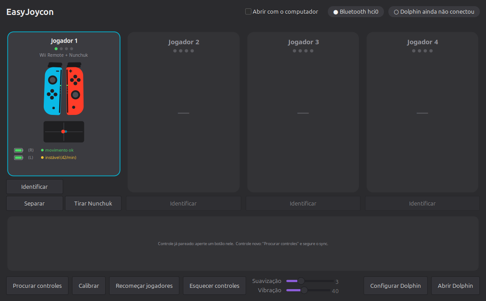

# EasyJoycon 🎮

Use os **Joy-Cons do Nintendo Switch como Wii Remote + Nunchuk no
[Dolphin](https://dolphin-emu.org)**, no Linux, com giroscópio e
acelerômetro — sem configurar nada na mão.



*English: EasyJoycon turns Nintendo Switch Joy-Cons (and the Pro Controller)
into Wii Remotes + Nunchuk for the Dolphin emulator on Linux, with motion
controls, Switch-style player setup and automatic Bluetooth pairing. Download
the AppImage from Releases; the UI is in Brazilian Portuguese.*

## O que ele faz

- **Conecta os controles pelo Bluetooth** como a tela de controles do
  Switch: clique em *Procurar controles* e segure o botãozinho de sync na
  lateral do Joy-Con. Pareia, guarda e conecta sozinho; depois é só
  apertar um botão no controle.
- **Monta os jogadores como no Switch**: segure **L + R** (um Joy-Con em
  cada mão) → Wii Remote + Nunchuk; **SL + SR** num Joy-Con sozinho → Wii
  Remote deitado; **R + ZR** (ou L + ZL) → Wii Remote em pé. Até 4
  jogadores; quem cai e volta, volta pro mesmo jogador.
- **Movimento liso e preciso**: lê o movimento direto do Joy-Con (como o
  Switch), calibra o giroscópio sozinho quando o controle fica parado,
  suaviza a tremedeira sem atrasar movimento rápido e disfarça os engasgos
  do Bluetooth.
- **Configura o Dolphin sozinho**: os 4 Wii Remotes, os controles de
  GameCube e a vibração. Separar, juntar, deitar ou tirar o Nunchuk vale
  com o jogo rodando.
- **Vibração dos jogos** no controle de cada jogador, imitando o motorzinho
  do Wii Remote.
- **Conserta conexão ruim** sozinho (controle conectado pela metade,
  calibração errada, controle travado) e avisa quando outro programa (a
  Steam, por exemplo) está atrapalhando.
- Mostra a **cor de verdade** de cada Joy-Con, a bateria e o que cada um
  está apertando; fica perto do relógio e pode abrir junto com o computador.

Também funciona com o **Pro Controller** (Wii Remote + Nunchuk num
controle só).

## Do que precisa

- **Linux** com Bluetooth (o do notebook serve; ver
  [Adaptador Bluetooth](#adaptador-bluetooth)). Testado no Linux Mint 22;
  deve funcionar em qualquer distribuição recente (kernel 5.16 ou mais
  novo, que já traz o driver dos controles da Nintendo).
- **Python 3.10+ e GTK 3** — já vêm instalados no Ubuntu 22.04+, Linux
  Mint 21+, Fedora e Debian 12 com área de trabalho. Se faltar, o app avisa
  o que instalar (no Ubuntu/Mint:
  `sudo apt install python3-gi python3-gi-cairo gir1.2-gtk-3.0`).
- **Dolphin** — pela loja de aplicativos do sistema (procure "Dolphin
  Emulator") ou `flatpak install flathub org.DolphinEmu.dolphin-emu`.

> [!WARNING]
> **Adaptadores Bluetooth USB falsificados podem não funcionar.** Os mais
> baratos, vendidos como "CSR 4.0" / "CSR8510", quase sempre são cópias: com
> eles os Joy-Cons engasgam, o pareamento trava no meio e o adaptador chega a
> cair do USB. Pra conferir o seu: `lsusb` mostrando `0a12:0001 Cambridge
> Silicon Radio` é esse tipo — ou rode o diagnóstico (veja
> [Problemas comuns](#problemas-comuns)), que diz se o adaptador é original
> ou cópia. Veja [Adaptador Bluetooth](#adaptador-bluetooth) pra saber qual
> usar.

## Instalar e usar

1. Baixe o `EasyJoycon-x.y.z-x86_64.AppImage` em
   [Releases](https://github.com/elielfreitascpv/EasyJoycon/releases/latest).
2. Clique com o botão direito no arquivo → *Propriedades* → *Permissões* →
   marque **"Permitir executar como programa"** (ou, no terminal:
   `chmod +x EasyJoycon-*.AppImage`). Abra com dois cliques. Ele aparece
   também no menu de aplicativos.
3. **Na primeira vez**, a janela mostra o aviso *"O sistema ainda não está
   preparado"*: clique em **Preparar o sistema** e digite a sua senha. Isso
   é feito uma vez só (o que muda está em
   [O que o "Preparar o sistema" faz](#o-que-o-preparar-o-sistema-faz)).
4. Clique em **Procurar controles** e segure o botão de sync (o pequeno, na
   lateral entre o SL e o SR) de cada Joy-Con, um de cada vez, até as luzes
   pararem de correr.
5. Segure **L + R** pra virar jogador 1 (veja os outros jeitos acima). As
   luzes do controle mostram o número do jogador, como no Switch.
6. Clique em **Abrir Dolphin**. Pronto: escolha o jogo e jogue.

**Pra mirar**: segure o controle do jeito mais confortável, aponte pro meio
da tela e **aperte o analógico** pra centralizar. Como no Switch, essa
pegada vira "apontando pra TV". Mudou a pegada? Aperte o analógico de novo.

### Botões

| Joy-Cons juntos (L + R) | Wii Remote / Nunchuk |
|---|---|
| A | A |
| ZR ou B | B (gatilho) |
| X / Y | 1 / 2 |
| − / + / HOME | − / + / HOME |
| setas do Joy-Con esquerdo | direcional |
| apertar o analógico direito | centralizar a mira |
| L / ZL | C / Z do Nunchuk |
| analógico esquerdo | analógico do Nunchuk |
| botão de captura (o quadradinho) | tirar/pôr o Nunchuk |

**Joy-Con em pé (R + ZR)**: A = A, ZR ou B = B, X / Y = 1 / 2, + / SL =
+ / −, analógico = direcional, apertar o analógico = centralizar a mira. No
Joy-Con esquerdo em pé, as setas fazem o papel de A/B/X/Y.

**Joy-Con deitado (SL + SR)**, como controle de NES: botão da direita = 2,
de baixo = 1, de cima = A, da esquerda ou SR = B, SL = −, analógico =
direcional. Clicar no cartão do jogador alterna entre deitado e em pé.

**GameCube** (com L + R juntos ou Pro Controller, como no GameCube do
Switch Online): analógico esquerdo = analógico, analógico direito =
C-Stick, ZL / ZR = gatilhos L / R, R = Z, + = Start.

### Teclas na janela

**P** procurar controles · **C** calibrar (deixe os controles parados por
2 s) · **[ ]** suavização · **R** recomeçar os jogadores

## Problemas comuns

- **O controle não volta sozinho quando aperto um botão** — ele foi
  pareado sem guardar a chave. A janela avisa numa faixa amarela: clique em
  **Parear de novo** e segure o sync de cada um.
- **Movimento ou analógico estranhos com a Steam aberta** — a Steam
  manda comandos próprios pros Joy-Cons. Feche a Steam e desligue e ligue o
  controle (a janela avisa quando ela está usando o controle).
- **"Falta o Dolphin"** ao clicar em Abrir Dolphin — instale o Dolphin (veja
  acima) e clique de novo.
- **O AppImage não abre** — confira o passo 2 (permissão de executar). Se
  aparecer um aviso de Python ou GTK, instale o que ele pede.
- **A mira treme ou "engasga"** — ajuste a *Suavização* na janela. Se os
  controles engasgam muito (a janela mostra "instável"), o problema costuma
  ser o adaptador Bluetooth (veja abaixo) ou a distância.
- **Diagnóstico completo**: no terminal,
  `./EasyJoycon-*.AppImage diagnostico` confere Bluetooth, permissões,
  controles e Dolphin e diz o que falta.

As configurações (suavização, zona morta, vibração, tempos…) ficam em
`~/.local/share/easyjoycon/config.toml`, com a explicação de cada uma. O log
fica em `~/.local/share/easyjoycon/logs/`.

### Adaptador Bluetooth

Adaptadores USB baratos vendidos como "CSR8510" (`0a12:0001`) quase sempre
são cópias: engasgam com mais de um controle, travam no meio do pareamento
e às vezes caem do USB. O EasyJoycon disfarça o que dá (segura o último
movimento durante um engasgo, pareia um controle por vez), mas não faz
milagre. O que funcionou bem nos testes:

- **adaptador USB com chip Realtek**, como o TP-Link UB500 (Bluetooth 5.x):
  praticamente sem engasgos com dois Joy-Cons;
- **Bluetooth interno do notebook (Intel)**: funciona, mas divide a antena
  com o Wi-Fi — se engasgar, deixe o Wi-Fi em 5 GHz ou use um adaptador USB.

Com dois adaptadores ligados (o interno e um USB), desligue um (o app usa o
que estiver ligado). A janela mostra "instável (N/min)" no controle que está
engasgando, e `./EasyJoycon-*.AppImage medir` mede e compara adaptadores.

### O que o "Preparar o sistema" faz

Uma vez só, com a sua senha (o script é o
[`scripts/instalar-sistema.sh`](scripts/instalar-sistema.sh)):

1. Faz o Bluetooth do Linux aceitar os Joy-Cons
   (`ClassicBondedOnly=false` em `/etc/bluetooth/input.conf`).
2. Libera pro seu usuário os controles da Nintendo e o controle virtual
   (`/dev/uinput`, usado pra vibração dos jogos, Nunchuk e modo deitado no
   Dolphin), com regras do udev em `/etc/udev/rules.d/`.
3. Desliga a economia de energia do USB nos adaptadores CSR8510 (eles caem
   com ela).
4. Desliga o `joycond`, se estiver instalado (o EasyJoycon faz o papel
   dele).

Pra desfazer: `scripts/desfazer-sistema.sh` (no código-fonte).

## Rodar pelo código-fonte

```bash
git clone https://github.com/elielfreitascpv/EasyJoycon.git
cd EasyJoycon
./easyjoycon.sh                 # na 1ª vez cria o ambiente Python (precisa de internet)
```

Outros comandos: `./easyjoycon.sh --terminal` (sem janela),
`./easyjoycon.sh diagnostico`, `./easyjoycon.sh testar` (mostra ao vivo o
que o Dolphin recebe), `./easyjoycon.sh medir` (mede os engasgos do
Bluetooth). Rodando pelo código, as configurações ficam em `data/`.

Pra quem quer mexer no código:

```bash
venv/bin/python tests/test_regressao.py   # testes (simulados, sem controle)
git config core.hooksPath .githooks       # roda lint + testes antes de cada commit
./scripts/fazer-appimage.sh               # monta o AppImage em dist/
```

### Como funciona

O Dolphin recebe os controles pelo protocolo **DSU/Cemuhook** (o mesmo dos
apps de giroscópio pra emulador), só em `127.0.0.1`. Os botões vêm do driver
`hid-nintendo` do Linux; o movimento é lido direto do Joy-Con (o relatório
0x30, com a calibração da memória dele). Sinais como "tem Nunchuk" e
"deitado" e a vibração dos jogos passam por controles virtuais
(`/dev/uinput`) que o Dolphin lê junto. Nada sai do seu computador.

## Créditos

- [dekuNukem/Nintendo_Switch_Reverse_Engineering](https://github.com/dekuNukem/Nintendo_Switch_Reverse_Engineering):
  o formato dos relatórios, da memória e da vibração HD dos Joy-Cons.
- O driver `hid-nintendo` do Linux (Daniel J. Ogorchock) e o
  [SDL](https://www.libsdl.org) (tabela de amplitudes da vibração,
  licença zlib).
- [GamepadMotionHelpers](https://github.com/JibbSmart/GamepadMotionHelpers),
  de Jibb Smart: ideias de calibração e suavização do giroscópio.
- O [Dolphin](https://dolphin-emu.org) e o seu cliente DSU.

Joy-Con, Nintendo Switch e Wii Remote são marcas da Nintendo. Este projeto
não tem nenhuma ligação com a Nintendo.

## Licença

[GPL-3.0](LICENSE): pode usar, estudar, mudar e redistribuir; quem
distribuir uma versão modificada tem que abrir o código dela também.
