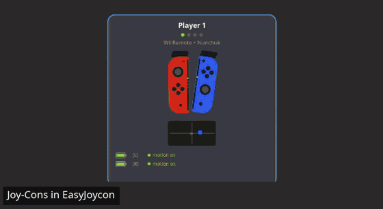

# EasyJoycon 🎮

**English** · [Português](README.pt-BR.md)

Use **Nintendo Switch Joy-Cons as a Wii Remote + Nunchuk in
[Dolphin](https://dolphin-emu.org)** on Linux, with gyro and accelerometer
motion controls — no manual setup.



📖 **New here? Read the [step-by-step guide](docs/how-to-use.md)** —
connecting, becoming a player, aiming and what each button does (also
opened by the **How to use** button in the app).

## What it does

- **Connects the controllers over Bluetooth**, like the Switch's controller
  screen: click *Search for controllers* and hold the small sync button on
  the side of the Joy-Con. It pairs, remembers and connects on its own;
  after that, just press a button on the controller.
- **Sets up players like the Switch**: hold **L + R** (one Joy-Con in each
  hand) → Wii Remote + Nunchuk; **SL + SR** on a single Joy-Con → sideways
  Wii Remote; **R + ZR** (or L + ZL) → upright Wii Remote. Up to 4 players;
  a controller that drops and comes back returns to the same player.
- **Smooth, precise motion**: reads motion straight from the Joy-Con (like
  the Switch does), calibrates the gyro by itself whenever the controller
  rests, smooths out hand jitter without adding lag to fast movements, and
  hides Bluetooth hiccups.
- **Configures Dolphin for you**: the 4 Wii Remotes, the GameCube
  controllers and rumble. Splitting, joining, turning sideways or unplugging
  the Nunchuk works while the game is running.
- **Game rumble** on each player's controller, imitating the Wii Remote's
  little motor.
- **Fixes bad connections** by itself (half-connected controller, wrong
  calibration, frozen controller) and tells you when another program (Steam,
  for example) is getting in the way.
- Shows each Joy-Con's **real color**, its battery and what's being pressed;
  sits next to the clock and can start with the computer.

The **Pro Controller** works too (Wii Remote + Nunchuk in a single
controller). The window is in English or Portuguese, following the system
language.

## Requirements

- **Linux** with Bluetooth (a laptop's built-in one works; see
  [Bluetooth adapter](#bluetooth-adapter)). Tested on Linux Mint 22; should
  work on any recent distribution (kernel 5.16 or newer, which ships the
  driver for Nintendo controllers).
- **Python 3.10+ and GTK 3** — already installed on Ubuntu 22.04+, Linux
  Mint 21+, Fedora and Debian 12 with a desktop. If something is missing,
  the app tells you what to install (on Ubuntu/Mint:
  `sudo apt install python3-gi python3-gi-cairo gir1.2-gtk-3.0`).
- **Dolphin** — from your system's app store (search for "Dolphin
  Emulator") or `flatpak install flathub org.DolphinEmu.dolphin-emu`.

> [!WARNING]
> **Counterfeit USB Bluetooth adapters may not work.** The cheapest ones,
> sold as "CSR 4.0" / "CSR8510", are almost always clones: with them the
> Joy-Cons stutter, pairing freezes halfway and the adapter even drops off
> USB. To check yours: `lsusb` showing `0a12:0001 Cambridge Silicon Radio`
> is that kind — or run the diagnostics (see
> [Troubleshooting](#troubleshooting)), which tell you whether the adapter
> is genuine or a clone. See [Bluetooth adapter](#bluetooth-adapter) for
> what to use.

## Install and use

1. Download `EasyJoycon-x.y.z-x86_64.AppImage` from
   [Releases](https://github.com/thel4stbolacha/EasyJoycon/releases/latest).
2. Right-click the file → *Properties* → *Permissions* → check **"Allow
   executing file as program"** (or, in the terminal:
   `chmod +x EasyJoycon-*.AppImage`). Double-click to open. It also shows
   up in the applications menu.
3. **The first time**, the window shows *"The system isn't set up for
   EasyJoycon yet"*: click **Set up the system** and type your password.
   This is done only once (what it changes is in
   [What "Set up the system" does](#what-set-up-the-system-does)).
4. Click **Search for controllers** and hold the sync button (the small one
   on the side, between SL and SR) of each Joy-Con, one at a time, until
   the lights stop running.
5. Hold **L + R** to become player 1 (see the other ways above). The
   controller lights show the player number, like on the Switch.
6. Click **Open Dolphin**. That's it: pick a game and play.


**To aim**: hold the controller however is comfortable, point at the
middle of the screen and **press the stick** to recenter. Like on the
Switch, that grip becomes "pointing at the TV". Changed your grip? Press the
stick again. More in the [guide](docs/how-to-use.md#5-aiming-press-the-stick-to-recenter).

### Buttons

| Joy-Cons together (L + R) | Wii Remote / Nunchuk |
|---|---|
| A | A |
| ZR or B | B (trigger) |
| X / Y | 1 / 2 |
| − / + / HOME | − / + / HOME |
| left Joy-Con arrows | D-pad |
| press the right stick | recenter the aim |
| L / ZL | Nunchuk C / Z |
| left stick | Nunchuk stick |
| capture button (the little square) | unplug/plug in the Nunchuk |

**Upright Joy-Con (R + ZR)**: A = A, ZR or B = B, X / Y = 1 / 2, + / SL =
+ / −, stick = D-pad, press the stick = recenter the aim. On an upright
left Joy-Con, the arrows act as A/B/X/Y.

**Sideways Joy-Con (SL + SR)**, like an NES controller: right button = 2,
bottom = 1, top = A, left or SR = B, SL = −, stick = D-pad. Clicking the
player card switches between sideways and upright.

**GameCube** (with L + R together or a Pro Controller, like the Switch
Online GameCube layout): left stick = stick, right stick = C-Stick,
ZL / ZR = L / R triggers, R = Z, + = Start.

### Window shortcuts

**P** search for controllers · **C** calibrate (keep the controllers still
for 2 s) · **[ ]** smoothing · **R** reset the players

## Troubleshooting

- **The controller doesn't come back when I press a button** — it was
  paired without saving the key. The window warns you in a yellow bar:
  click **Pair again** and hold the sync button on each one.
- **Weird motion or stick with Steam open** — Steam sends the Joy-Cons its
  own commands. Close Steam and turn the controller off and on (the window
  tells you when Steam is using the controller).
- **"Dolphin is missing"** when clicking Open Dolphin — install Dolphin
  (see above) and click again.
- **The AppImage doesn't open** — check step 2 (permission to execute). If
  a Python or GTK warning shows up, install what it asks for.
- **The aim jitters or "stutters"** — adjust *Smoothing* in the window. If
  the controllers stutter a lot (the window shows "unstable"), the culprit
  is usually the Bluetooth adapter (see below) or the distance.
- **Full diagnostics**: in the terminal,
  `./EasyJoycon-*.AppImage diagnostico` checks Bluetooth, permissions,
  controllers and Dolphin and tells you what's missing (the terminal
  commands still print in Portuguese).

Settings (smoothing, dead zone, rumble, timings…) live in
`~/.local/share/easyjoycon/config.toml`, with an explanation of each one
(in Portuguese). The log is in `~/.local/share/easyjoycon/logs/`.

### Bluetooth adapter

Cheap USB adapters sold as "CSR8510" (`0a12:0001`) are almost always
clones: they stutter with more than one controller, freeze halfway through
pairing and sometimes drop off USB. EasyJoycon hides what it can (holds the
last movement during a hiccup, pairs one controller at a time), but it
can't work miracles. What worked well in testing:

- **USB adapter with a Realtek chip**, like the TP-Link UB500 (Bluetooth
  5.x): practically no stutters with two Joy-Cons;
- **Laptop's built-in Bluetooth (Intel)**: works, but shares the antenna
  with Wi-Fi — if it stutters, put Wi-Fi on 5 GHz or use a USB adapter.

With two adapters on (the built-in one and a USB one), turn one off (the
app uses whichever is on). The window shows "unstable (N/min)" on the
controller that's stuttering, and `./EasyJoycon-*.AppImage medir` measures
and compares adapters.

### What "Set up the system" does

Only once, with your password (the script is
[`scripts/instalar-sistema.sh`](scripts/instalar-sistema.sh)):

1. Makes Linux Bluetooth accept the Joy-Cons
   (`ClassicBondedOnly=false` in `/etc/bluetooth/input.conf`).
2. Gives your user access to the Nintendo controllers and the virtual
   controller (`/dev/uinput`, used for game rumble, the Nunchuk and
   sideways mode in Dolphin), with udev rules in `/etc/udev/rules.d/`.
3. Turns off USB power saving on CSR8510 adapters (they drop with it).
4. Turns off `joycond`, if installed (EasyJoycon does its job).

To undo: `scripts/desfazer-sistema.sh` (in the source code).

## Run from source

```bash
git clone https://github.com/thel4stbolacha/EasyJoycon.git
cd EasyJoycon
./easyjoycon.sh                 # the first time it creates the Python environment (needs internet)
```

Other commands: `./easyjoycon.sh --terminal` (no window),
`./easyjoycon.sh diagnostico`, `./easyjoycon.sh testar` (shows live what
Dolphin receives), `./easyjoycon.sh medir` (measures Bluetooth stutters).
Running from source, settings live in `data/`.

For those who want to hack on the code (it's commented in Portuguese):

```bash
venv/bin/python tests/test_regressao.py   # tests (simulated, no controller needed)
git config core.hooksPath .githooks       # runs lint + tests before each commit
./scripts/fazer-appimage.sh               # builds the AppImage in dist/
```

### How it works

Dolphin receives the controllers through the **DSU/Cemuhook** protocol (the
same one used by gyro apps for emulators), only on `127.0.0.1`. Buttons
come from Linux's `hid-nintendo` driver; motion is read straight from the
Joy-Con (report 0x30, with the calibration stored in its memory). Signals
like "Nunchuk attached" and "sideways", plus game rumble, go through
virtual controllers (`/dev/uinput`) that Dolphin reads alongside. Nothing
leaves your computer.

## Credits

- [dekuNukem/Nintendo_Switch_Reverse_Engineering](https://github.com/dekuNukem/Nintendo_Switch_Reverse_Engineering):
  the format of the Joy-Cons' reports, memory and HD rumble.
- Linux's `hid-nintendo` driver (Daniel J. Ogorchock) and
  [SDL](https://www.libsdl.org) (rumble amplitude table, zlib license).
- [GamepadMotionHelpers](https://github.com/JibbSmart/GamepadMotionHelpers),
  by Jibb Smart: gyro calibration and smoothing ideas.
- [Dolphin](https://dolphin-emu.org) and its DSU client.

Joy-Con, Nintendo Switch and Wii Remote are trademarks of Nintendo. This
project is not affiliated with Nintendo in any way.

## License

[GPL-3.0](LICENSE): you can use, study, change and redistribute it; anyone
who distributes a modified version must release its source code too.
