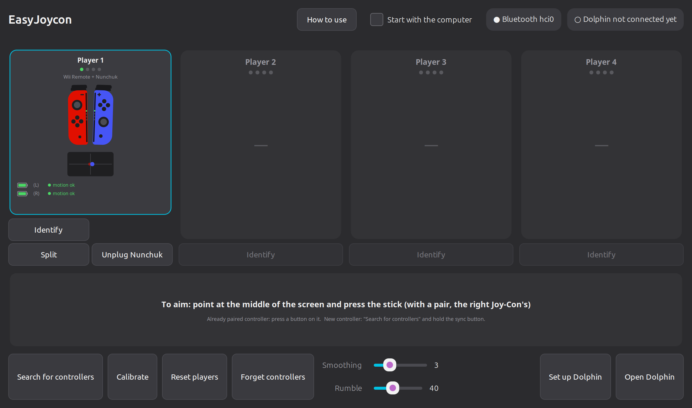

# How to use EasyJoycon

**English** · [Português](como-usar.md)

A step-by-step guide, from the first time you open the app to aiming in a
Wii game. To install, see the [README](../README.md#install-and-use).

**Contents:** [1. First time](#1-first-time) ·
[2. Connect the controllers](#2-connect-the-controllers) ·
[3. Become a player](#3-become-a-player) ·
[4. Play in Dolphin](#4-play-in-dolphin) ·
[5. Aiming](#5-aiming-press-the-stick-to-recenter) ·
[6. Nunchuk](#6-nunchuk) · [7. Buttons](#7-buttons) ·
[8. The window, piece by piece](#8-the-window-piece-by-piece) ·
[9. Next time](#9-next-time)

## 1. First time

Open EasyJoycon. If a yellow bar says *"The system isn't set up for
EasyJoycon yet"*, click **Set up the system** and type your password. This
is done only once: it lets Linux Bluetooth accept the Joy-Cons and gives
you access to the controllers (details in the
[README](../README.md#what-set-up-the-system-does)).

> If **Steam** is open, close it before connecting: it sends the Joy-Cons
> its own commands and can break the calibration. The window warns you
> when that happens.

## 2. Connect the controllers

1. Click **Search for controllers** (or press **P** in the window).
2. Hold the **sync button** of a Joy-Con — the small round one on the
   side rail, between SL and SR — until its lights start running.
3. Wait for it to show up in the bottom strip of the window, then do the
   next one. **One controller at a time** works best.
4. Done? Press **A** on any controller (or click **Stop searching**).

From then on you don't need to pair again: just **press any button** on
the controller and it reconnects on its own.

## 3. Become a player

Connected controllers wait in the bottom strip. Just like on the Switch,
how you hold them decides what they become:

| Hold… | You get | Good for |
|---|---|---|
| **L + R** (one Joy-Con in each hand) | Wii Remote + Nunchuk | most games |
| **SL + SR** on a single Joy-Con | sideways Wii Remote | NES-style games, Mario Kart Wii |
| **R + ZR** (or L + ZL) on a single Joy-Con | upright Wii Remote, no Nunchuk | pointing games without Nunchuk |
| **L + R** on a **Pro Controller** | Wii Remote + Nunchuk in one controller | — |

When nobody is playing yet and the only controllers waiting are one left
and one right Joy-Con (or a single Pro Controller), they become player 1
on their own after 3 seconds.

The controller lights show the player number, like on the Switch. Up to 4
players. If a controller drops and comes back, it returns to the same
player.

Changed your mind? Under each player card:

- **Identify** — rumbles and lights up that player's controller.
- **Split** / **Join** — splits an L + R pair into two upright Wii
  Remotes, or joins two single Joy-Cons into a Wii Remote + Nunchuk.
- **Use upright** / **Use sideways** — switches a single Joy-Con between
  the two (clicking the player card does the same).
- **Reset players** (bottom bar, or **R**) — everyone goes back to the
  waiting strip.

## 4. Play in Dolphin

Click **Open Dolphin**. EasyJoycon sets up Dolphin's Wii Remotes,
Nunchuks, GameCube controllers and rumble on its own before opening it —
there's nothing to configure inside Dolphin. Pick a game and play.

- The top of the window says **● Dolphin receiving** when Dolphin is
  reading the controllers.
- Splitting, joining, turning sideways and unplugging the Nunchuk all
  work **with the game running**.
- Dolphin only reads the controllers while **its window has focus**:
  click on the game window after using the EasyJoycon window.

## 5. Aiming: press the stick to recenter

This is the most important part. The Joy-Con doesn't have the Wii's
sensor bar, so it doesn't know where your TV is. **You tell it:**

1. Hold the controller however is comfortable.
2. Point at the **middle of the screen**.
3. **Press the stick** (click it down like a button).

That grip now counts as "pointing at the TV", like on the Switch. Do it
again whenever:

- the pointer drifts away from where you're pointing;
- you change your grip or the way you're sitting;
- the pointer has disappeared — it vanishes when you point off the screen,
  like on a real Wii.

Which stick:

| You're playing as… | Press… |
|---|---|
| Wii Remote + Nunchuk (L + R) | the **right** Joy-Con's stick |
| upright or sideways Joy-Con | that Joy-Con's stick |
| Pro Controller | either stick |

The little dark screen inside the player card shows where you're
pointing, like Dolphin's pointer. A yellow border means you're pointing
off the screen.

## 6. Nunchuk

With L + R (or the Pro Controller), the left Joy-Con is the Nunchuk:
**left stick** = Nunchuk stick, **L** = C, **ZL** = Z. Shaking it works
too.

Some games ask you to unplug or plug in the Nunchuk. Press the **capture
button** (the little square on the left Joy-Con) or click **Unplug
Nunchuk** / **Plug in Nunchuk** under the player card.

## 7. Buttons

| Joy-Cons together (L + R) | Wii Remote / Nunchuk |
|---|---|
| A | A |
| ZR or B | B (trigger) |
| X / Y | 1 / 2 |
| − / + / HOME | − / + / HOME |
| left Joy-Con arrows | D-pad |
| press the right stick | **recenter the aim** |
| L / ZL | Nunchuk C / Z |
| left stick | Nunchuk stick |
| capture button | unplug/plug in the Nunchuk |

Upright, sideways and GameCube layouts are in the
[README](../README.md#buttons).

## 8. The window, piece by piece

**Status next to each controller** (inside the player card):

| Says… | Means |
|---|---|
| ● motion ok | all good |
| ● calibrating… | leave it still for a moment |
| ● set it down for 2 s | put it on the table for 2 seconds so it calibrates |
| ● unstable (N/min) | Bluetooth is stuttering (adapter or distance — see the [README](../README.md#bluetooth-adapter)) |
| ● no data / zeroed, reconnecting | the controller froze; EasyJoycon reconnects it on its own |
| (L) dropped — press a button on it | it disconnected; press a button to bring it back |

**Bottom bar:**

- **Calibrate** (or **C**) — leave the controllers still on the table and
  click; use it if the pointer keeps drifting with the controller still.
  EasyJoycon also calibrates on its own whenever a controller rests for
  about 2 seconds.
- **Smoothing** (or **[** and **]**) — 0 = fastest, 10 = smoothest. Raise
  it if the pointer shakes; lower it if it feels slow.
- **Rumble** — strength of game rumble; 0 turns it off.
- **Forget controllers** — removes all Joy-Cons and Pro Controllers from
  this computer's Bluetooth, to pair from scratch.
- **Set up Dolphin** — applies the current players to Dolphin (with
  Dolphin closed). Usually not needed: **Open Dolphin** already does it.

**Top bar:** **Start with the computer** starts EasyJoycon hidden next to
the clock when you log in; **How to use** opens this page.

## 9. Next time

Closing the window doesn't close EasyJoycon: it keeps running next to the
clock and the controllers keep working (to quit for good: clock icon →
**Quit**). Next time, just open the app, **press a button** on each
controller, hold **L + R** and click **Open Dolphin**.

With Dolphin closed, a controller nobody touches for 10 minutes is turned
off to save battery — press any button to bring it back.

Something not working? See
[Troubleshooting](../README.md#troubleshooting) in the README.
